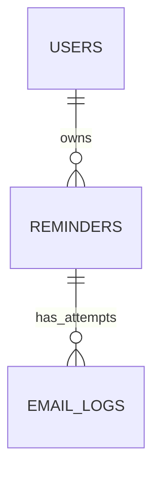

# Database design: learning checkpoint

This is a proposed design, not an executed database migration. The learner has since created the application database and restricted account and verified live Spring-to-MySQL connectivity. The learner has applied the initial schema and supplied matching constraint/index metadata; constraint behavior tests remain pending. The health endpoint was independently verified by the learner using PowerShell. Its Postman result remains unconfirmed.

## Relationships

One user owns zero or more reminders. Each reminder belongs to exactly one user. One reminder has zero or more email-attempt logs. Each attempt log belongs to exactly one reminder. A newly created reminder has no attempts.

## Primary and foreign keys

A primary key identifies one row, such as users.id. A foreign key points to a row in another table, such as reminders.user_id referencing users.id. Database constraints prevent an orphan reminder or attempt log. Foreign keys do not enforce API authorization: services must also restrict queries to the authenticated owner.

## Proposed columns

### users

| Column | MySQL type | Purpose |
| --- | --- | --- |
| id | BIGINT | Generated primary key |
| email | VARCHAR(254) | Required unique normalized login email |
| password_hash | VARCHAR(255) | Required BCrypt password hash, never a plaintext password |
| display_name | VARCHAR(100) | Required display name |
| time_zone | VARCHAR(64) | Required IANA zone ID, for example Asia/Kolkata |
| token_version | BIGINT | Required default 0; supports invalidating all existing JWTs for this account |
| created_at | DATETIME(6) | Required UTC creation timestamp |
| updated_at | DATETIME(6) | Required UTC update timestamp |

The initial token-management design uses short-lived access JWTs and an account token version checked during authenticated requests. Logout increments the version, revoking all that user's active access tokens. Per-device sessions or refresh-token rotation would need additional server-side session records; that is not claimed by this three-table design.

### reminders

| Column | MySQL type | Purpose |
| --- | --- | --- |
| id | BIGINT | Generated primary key |
| user_id | BIGINT | Required foreign key to users.id |
| title | VARCHAR(200) | Required reminder title |
| recipient_email | VARCHAR(254) | Required destination address |
| recipient_name | VARCHAR(100) | Optional template greeting name |
| message | TEXT | Required reminder message, with an application validation limit |
| scheduled_at | DATETIME(6) | Required due instant, stored as UTC |
| time_zone | VARCHAR(64) | Required zone selected when scheduling |
| status | VARCHAR(20) | Required allowed reminder status |
| attempt_count | INT | Required default 0; number of attempts begun |
| retry_count | INT, generated and stored | Automatically calculated as max(attempt_count - 1, 0); application must not write it |
| max_retries | INT | Required nonnegative policy snapshot when created |
| next_attempt_at | DATETIME(6) | UTC next eligible processing time; null for terminal states |
| claim_token | VARCHAR(36) | Nullable unique worker-claim identifier |
| lease_until | DATETIME(6) | Nullable UTC expiry of worker ownership |
| version | BIGINT | Required optimistic-lock version for concurrent updates |
| deleted_at | DATETIME(6) | Optional UTC soft-deletion time, preserving history |
| created_at | DATETIME(6) | Required UTC creation timestamp |
| updated_at | DATETIME(6) | Required UTC update timestamp |

The initial attempt is not a retry. With max_retries = 3, there are at most 4 automatically scheduled attempts for definite failures. retry_count is generated and stored by MySQL as max(attempt_count - 1, 0), so a second application-managed counter cannot drift out of sync.

### email_logs

| Column | MySQL type | Purpose |
| --- | --- | --- |
| id | BIGINT | Generated primary key |
| reminder_id | BIGINT | Required foreign key to reminders.id |
| attempt_number | INT | Required positive attempt sequence |
| claim_token | VARCHAR(36) | Required token linking the attempt to a worker claim |
| reminder_title | VARCHAR(200) | Required title snapshot for historical display |
| recipient_email | VARCHAR(254) | Required recipient snapshot |
| started_at | DATETIME(6) | Required UTC time the attempt began |
| completed_at | DATETIME(6) | Nullable UTC outcome-recording time |
| status | VARCHAR(20) | STARTED, SMTP_ACCEPTED, FAILED, or UNKNOWN |
| failure_reason | VARCHAR(2000) | Optional sanitized and truncated error detail |

Snapshots prevent later reminder edits from changing what earlier attempts appear to have sent. Secrets, complete SMTP transcripts, and credentials must not be logged. An UNKNOWN outcome records that acceptance could not be determined, such as a process crash or an ambiguous transport error after sending data.

## Constraints and indexes

- Primary key on every id.
- Unique users.email after application normalization.
- Required fields use NOT NULL.
- Foreign keys use RESTRICT rather than deleting delivery history implicitly.
- Unique email_logs(reminder_id, attempt_number) prevents duplicate attempt-number records; it cannot prevent duplicate SMTP messages by itself.
- CHECK constraints restrict statuses and nonnegative counters.
- Index reminders(status, next_attempt_at, id) supports finding due work.
- Index reminders(user_id, created_at, id) supports listing an owner's reminders.
- Index reminders(status, lease_until) supports finding expired processing claims.
- Index email_logs(reminder_id, started_at, id) supports attempt history.

An index helps MySQL find matching rows without scanning every row. It also takes space and adds work to writes, so indexes follow actual query patterns.

## Reminder state meanings

- PENDING: waiting for its initial due time.
- PROCESSING: claimed by one worker.
- SENT: SMTP accepted the email submission; inbox delivery is not confirmed.
- RETRY: waiting for another attempt following a definite failure.
- FAILED: retry budget exhausted, or uncertain outcome stopped automatic sending for review.
- CANCELLED: stopped by its owner before a worker begins sending.

Normal path: PENDING -> PROCESSING -> SENT.
Definite failure path: PROCESSING -> RETRY -> PROCESSING, eventually SENT or FAILED.
Cancellation is allowed for PENDING and RETRY. Editing is allowed for those states and cannot race successfully with claiming; final SQL and service logic must enforce that condition atomically. Soft deletion is allowed only for terminal states and retains audit rows. An in-flight SMTP operation cannot reliably be recalled.

## Time handling

Use Java Instant for database instants and UTC database connections. DATETIME(6) stores six fractional-second digits but does not contain zone information or automatically make a value UTC. The application and connection configuration must apply the UTC convention consistently.

The browser supplies an explicit IANA zone and an unambiguous instant (an ISO-8601 timestamp with an offset). The backend validates and converts it to UTC. Local times that do not exist, or occur twice during daylight-saving transitions, need rejection or an explicit choice before conversion.

Example: 2026-11-13 09:00 in Asia/Kolkata corresponds to 2026-11-13T03:30:00Z. The frontend converts stored UTC instants to the selected display zone.

## Reliability requirements before scheduler implementation

Workers will claim due work atomically in a short database transaction, persist an attempt start, and commit. SMTP calls happen outside the database transaction. A separate short transaction records the outcome only if the worker still owns the claim. Claim tokens fence stale workers from overwriting a later worker's database state; they do not fence SMTP itself.

Expired claims and ambiguous SMTP outcomes must not be blindly resent, because the provider may already have accepted the message. Exactly-once SMTP delivery cannot be guaranteed across the database/network boundary. We will implement an explicit uncertain-outcome policy and explain its tradeoff before enabling automatic retries.

The reminders table is initially a durable work queue. A transactional outbox is a related pattern that commits a business change and a separate pending event in the same database transaction. If a separate outbox is introduced, it requires an additional table. Neither pattern makes SMTP side effects transactional or guarantees recipient inbox delivery.

## Next checkpoint

Review the relationships and meanings first. Then create a local application database and a restricted application account, without using root as the application's login. Explain and test those commands before implementing entities or migrations.

