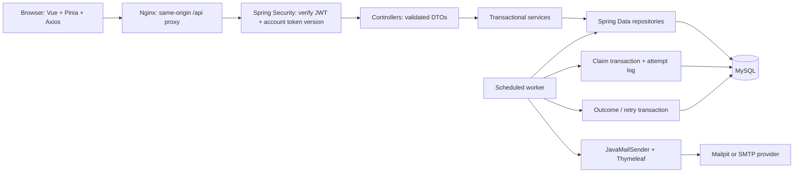

# Complete application guide

This continues the earlier beginner lessons after the request to implement the remaining modules in one stretch. Source files contain complete implementations; the earlier lessons explain the schema and mappings. This guide explains how the finished layers communicate and how to run, test, and deploy them.

## 1. Start the application on this Windows computer

The verified local deployment uses Docker Compose, a separate MySQL container, and generated credentials. It does not need the password of the existing Windows MySQL service. Docker Desktop must show that its Linux engine is running.

Open PowerShell and select the project:

```powershell
Set-Location 'C:\Users\avina\OneDrive\Documents\ChatGPT\study\ReminderService'
```

Set-Location changes the current folder. The folders and files are already created. To inspect the top level:

```powershell
Get-ChildItem -Name
```

For a fresh checkout only, generate secrets if .env is absent:

```powershell
if (-not (Test-Path -LiteralPath '.env')) {
    powershell.exe -NoProfile -ExecutionPolicy Bypass -File .\tools\init-env.ps1
}
```

Test-Path checks existence. The script creates independent random database/root/JWT values and restricts the file's Windows permissions. It never overwrites an existing .env or displays its values. The execution-policy override applies only to that child PowerShell process. Unix/CI users can run node tools/init-env.mjs instead; that version creates the file with mode 0600.

Validate, build, and start:

```powershell
docker compose config --quiet
docker compose up --build -d
docker compose ps
```

config --quiet checks the configuration without printing secrets. --build builds images from the Dockerfiles. -d leaves containers running in the background. ps shows status. First builds need network access and take longer. Expected: db and backend healthy, frontend and mailpit running.

Open http://localhost:8088. Create your own account and sign in. The test accounts created by verification are synthetic fixtures, not your personal login. A fresh installation defaults to Mailpit: captured email is visible at http://localhost:8025 and is not delivered externally. This computer's running deployment has since been configured privately for Gmail; reminder 9 was accepted by Gmail SMTP on its first attempt. Inbox arrival remains subject to recipient confirmation. Use tools/configure-gmail.ps1 for a hidden local App Password prompt; never share the credential in chat.

| Address | Purpose |
| --- | --- |
| http://localhost:8088 | Vue application and same-origin /api proxy |
| http://localhost:18081/api/health | Direct backend reachability check |
| http://localhost:18081/actuator/health/database | Database readiness check |
| http://localhost:8025 | Mailpit mailbox |
| 127.0.0.1:3307 | Container MySQL, if direct inspection is needed |
| 127.0.0.1:1026 | Mailpit SMTP from the host; containers use mailpit:1025 |

The backend uses port 8080 inside its container, published as host 18081 because an existing process occupied host 8080. Set BACKEND_PORT in .env to another free host port if needed. It does not change the internal frontend-to-backend address.

## 2. Architecture and request travel



The browser sends JSON and a Bearer token. Nginx forwards /api requests to backend:8080. Security checks signature, issuer, time validity, user existence, and token version. A controller validates the request and calls a service. Services enforce ownership and business rules, then repositories load or write entities. Controllers return DTOs, never password hashes or database entities.

The scheduler runs in the server independently of browser tabs. Closing the frontend does not stop it. The server and database must remain running for scheduled execution. The UI refreshes dashboard status every 15 seconds; it does not send the emails itself.

## 3. Authentication module

Files: config/SecurityConfig.java, service/AuthService.java, controller/AuthController.java, dto/ApiModels.java, exception/*.java.

@Configuration declares infrastructure. @Bean supplies the password encoder, JWT encoder/decoder, CORS policy, security filter chain, and Clock. @Service declares business services. @RestController declares HTTP handlers. @RequestBody converts JSON into DTOs, @Valid executes validation, and @AuthenticationPrincipal supplies the verified JWT.

register normalizes email, checks password byte length, validates the zone, BCrypt-encodes the password, and saves a User in a transaction. Unique email is also enforced by the database to resolve concurrent registration races. BCrypt is a one-way salted hash, not reversible encryption. DTOs enforce required fields, email syntax, lengths, and a minimum password length. BCrypt input is limited to 72 UTF-8 bytes.

login checks credentials and issues an HS256 token with issuer smart-reminder, user-ID subject, issue/expiry times, random token ID, and account token-version claim v. A dummy hash is checked for an unknown account to avoid skipping the expensive password comparison. Error responses do not distinguish an unknown email from a wrong password.

JWT_SECRET must be at least 32 UTF-8 bytes; the generator supplies a random longer value. Access tokens last 15 minutes by default. Expired, malformed, unexpected-issuer, revoked, or nonexistent-user tokens are rejected with 401. JWT_TTL_SECONDS may be 60-3600.

logout increments users.token_version atomically. Subsequent requests with older tokens fail validation. This signs out all devices for the account, not only one device. Every authenticated request checks the database version, trading a database read for immediate revocation. There is no refresh-token/session table; after expiry, sign in again.

The frontend stores its short-lived token in sessionStorage, attaches it through an Axios interceptor, and clears it after invalid-session responses. Session storage is still accessible to JavaScript; the frontend uses escaped Vue interpolation, no v-html, and a CSP. Logout needs a server connection for revocation; local clearing alone cannot revoke an offline token. Request/credential payloads must not be logged.

CSRF is disabled because authentication uses an explicit Authorization header and no authentication cookies. CORS allows configured origins, not arbitrary origins. Nginx limits login/registration request rates and caps request bodies. Public internet use should go through the HTTPS edge described below; do not publish the development backend port.

## 4. Reminder module

ReminderController maps URLs to ReminderService. The authenticated subject supplies owner ID; request JSON cannot choose another owner. Repository methods include both record ID and owner ID. A different owner's record returns 404 rather than revealing whether it exists.

create validates a future UTC instant and a Java time-zone ID, loads the owner, and saves a PENDING reminder. Its initial next_attempt_at equals scheduled_at. Maximum retries are copied from configuration so a later global policy change does not silently change existing reminders.

list returns a bounded page ordered by scheduled time and ID. get returns one owned, non-deleted reminder. update requires the current version from the last GET and permits only PENDING/RETRY; @Version rejects racing worker or user updates. cancel changes PENDING/RETRY to CANCELLED and clears next_attempt_at. A processing SMTP operation cannot be recalled. delete allows only CANCELLED/SENT/FAILED and sets deleted_at; it preserves delivery history.

When editing a RETRY reminder, counters and retry policy are preserved. Repeated scheduling does not reset the delivery budget. The message limit is 10,000 Java characters, within the MySQL TEXT storage limit for this application.

## 5. UTC and local time

The Vue form asks for a local date/time and an IANA zone. @js-temporal/polyfill converts it into an ISO timestamp with an unambiguous UTC instant. Its disambiguation=reject policy blocks nonexistent or repeated daylight-saving times. The user must choose another unambiguous local time; the app does not silently choose a fold.

For example, 09:00 Asia/Kolkata becomes 03:30Z. Java stores Instant values with UTC JDBC conversion, and DATETIME(6) uses a UTC convention. DATETIME does not contain zone metadata. Each reminder also stores its selected zone for rendering. Changing the profile zone changes history display and new reminder defaults, not existing scheduled instants.

## 6. Email and retry module

SmtpEmailDelivery implements EmailDelivery. It renders resources/templates/reminder-email.html through Thymeleaf and creates MIME plain-text and HTML alternatives with JavaMailSender. th:text escapes user content. Recipient name, title, message, and formatted scheduled time are dynamic. The claim token is an observation header, not a provider-enforced idempotency key.

Email construction errors, authentication failures, connection refusal, invalid recipient addresses, and explicit SMTP submission rejection are classified as definite failures where appropriate. Generic transport/time-out errors are conservative UNKNOWN outcomes because the server might already have accepted the DATA. A partially reported send is also uncertain. Stored reasons are classified messages, not raw exceptions or credentials. EmailLog bounds and normalizes already-safe reasons; it does not magically redact arbitrary secrets.

SMTP_ACCEPTED means the provider accepted responsibility for the submission. It does not prove inbox placement, reading, or absence of later bounces. There is no bounce webhook or provider-delivery event integration in this SMTP application.

Retries use base * 2^(attempt-1), capped by RETRY_CAP_SECONDS. Defaults: 30, 60, 120 seconds; MAX_RETRIES=3 allows four total attempts. Definite failures become RETRY until the budget is exhausted, then FAILED. Every attempt has a separate durable log. UNKNOWN becomes FAILED with an UNKNOWN log and no automatic resend. Its history explains that manual review is needed; there is deliberately no blind retry endpoint for uncertain messages.

## 7. Atomic claiming, transactions, and restart recovery

ReminderScheduler uses @Scheduled and is enabled by @EnableScheduling. Each tick first recovers expired PROCESSING leases, then selects due PENDING/RETRY candidate IDs in bounded batches. Candidate selection does not grant ownership.

WorkTransactionService.claim performs a conditional UPDATE against current status/time/budget/deletion conditions, increments attempt count and version, clears next_attempt_at, and records a unique claim token/lease. Only one competing transaction can update the due row. It creates the STARTED audit record in the same database transaction, then commits. A failed audit insert rolls back the claim too.

SMTP runs outside the database transaction. Holding a row lock across an unpredictable network call would block other work and would not make the network side effect transactional.

finish starts another transaction. It updates only the PROCESSING row that still owns this exact token, sets SENT/RETRY/FAILED, clears claim/lease, sets the next attempt if applicable, and updates the corresponding log atomically. Replaying the result or reporting from a stale worker does not overwrite a terminal outcome. Bulk worker updates explicitly increment version because bulk SQL bypasses normal entity callbacks.

On a crash, the committed PROCESSING/STARTED state survives. Lease expiry marks the reminder FAILED and its log UNKNOWN. It does not requeue it. This avoids automatically duplicating an email that may already have been accepted. A late original worker cannot replace that recovered outcome. In a normal shutdown the worker stops claiming new work and gets time to finish its current send; hard termination can still produce UNKNOWN.

Exactly-once SMTP delivery cannot be guaranteed: acceptance might occur immediately before a database failure or lost response. Lease/claim/unique-key mechanisms reduce database duplicate processing but cannot reverse an accepted SMTP message. Multiple instances require shared database state and synchronized clocks; the H2 test exercises competing transactions, while live MySQL tests exercise the complete single-deployment flow.

### Transactional outbox pattern

A traditional outbox writes a business change and an outbound event into separate tables in one transaction. A publisher later forwards the durable event to a broker/provider and records progress. It removes the gap between committing a business change and scheduling publication, but the publisher still needs idempotency/uncertain-outcome handling.

Here the reminders row is itself the durable scheduled-work record. Creating it transactionally schedules future work; claiming it and starting its audit record are also atomic. email_logs is an attempt audit, not a broker outbox. No separate outbox/broker is implemented, and the three-table design should not be described as a separate outbox implementation. Add an outbox table if later publishing independent domain events to a broker.

## 8. API reference and examples

All protected calls use Authorization: Bearer ACCESS_TOKEN. Times are ISO-8601 instants. List endpoints accept page >= 0 and size 1-100 and return content/page/size/totalElements/totalPages. Entity hashes, token versions, and SMTP claim tokens are not exposed in user DTOs.

| Method | Path | Result |
| --- | --- | --- |
| POST | /api/auth/register | 201 user profile |
| POST | /api/auth/login | 200 token, expiry, profile |
| POST | /api/auth/logout | 204, revoke all account tokens |
| GET / PUT | /api/profile | 200 profile |
| POST | /api/reminders | 201 reminder |
| GET | /api/reminders | 200 page |
| GET / PUT | /api/reminders/{id} | 200 owned reminder |
| POST | /api/reminders/{id}/cancel | 200 cancelled reminder |
| DELETE | /api/reminders/{id} | 204 soft deletion |
| GET | /api/reminders/history | 200 attempt-history page |
| GET | /api/email-logs/{reminderId} | 200 owned reminder's attempt history |
| GET | /api/dashboard | 200 status counts, upcoming reminders, recent logs |

Register example (choose your own password privately; this value is an example only):

```json
{"email":"learner@example.test","password":"EXAMPLE_ONLY_CHANGE_ME","displayName":"Learner","timeZone":"Asia/Kolkata"}
```

Create example (select a future instant when testing):

```json
{"title":"Renew insurance","recipientEmail":"capture@example.test","recipientName":"Learner","message":"Review the renewal documents.","scheduledAt":"2099-01-01T03:30:00Z","timeZone":"Asia/Kolkata"}
```

For PUT, send the same fields plus the current version returned by GET. Do not hardcode version=0 after another edit.

Expected errors: 400 invalid input/time/zone/page; 401 missing/invalid/expired/revoked token; 403 forbidden origin or access; 404 absent/not-owned record; 409 duplicate email, stale update, or invalid state transition; 429 auth rate limit; 500 sanitized internal failure. Validation responses contain fields keyed by DTO property, without rejected password values. Database readiness returns 503 when unavailable.

## 9. Vue pages and API connections

| Page | Main API connections |
| --- | --- |
| LoginView | POST auth/login; stores session token/profile |
| RegisterView | POST auth/register; redirects to login |
| DashboardView | GET dashboard, refresh every 15 seconds |
| CreateReminderView | Shared ReminderEditor, POST reminders |
| ReminderListView | GET page; cancel and soft-delete actions |
| EditReminderView | GET owned reminder; PUT with version |
| HistoryView | GET reminders/history or email-logs/{id} |
| SettingsView | GET/PUT profile |

Composition API refs/reactive hold UI state. Vue Router guards protected pages before navigation. Pinia stores the account session. Axios attaches the token and triggers session clearing on unauthorized protected responses. Buttons are disabled while requests are active. Forms use native required/email/length checks and show server errors. Reusable badges, pagination, and reminder forms keep pages consistent. The sidebar has mobile navigation with hidden controls made inert while closed. Vue interpolation escapes history/message values; no raw user HTML is rendered.

## 10. Run tests and inspect evidence

Backend tests and executable JAR:

```powershell
Set-Location 'C:\Users\avina\OneDrive\Documents\ChatGPT\study\ReminderService\backend'
.\mvnw.cmd verify
```

Expected verified result: 27 tests, 0 failures, 0 errors; BUILD SUCCESS. Tests select H2 and disable automatic scheduler ticks. They cover repositories, HTTP CRUD/ownership/validation, BCrypt, JWT expiry/issuer/revocation, CORS, competing claims, retries/max limit, lease recovery, stale results, template escaping, SMTP classification, and backoff. Mockito replaces SMTP in the unit tests.

Frontend:

```powershell
Set-Location '..\frontend'
npm.cmd ci
npm.cmd test
npm.cmd run build
npm.cmd audit --audit-level=moderate
```

Expected verified result: 3 time-zone tests pass, production build succeeds, zero known npm vulnerabilities at verification time. The lockfile was regenerated cleanly for cross-platform optional packages and verified by the Linux Docker build.

Postman: import documentation/postman/SmartReminder.postman_collection.json. Set collection baseUrl to http://localhost:8088. Run requests in order, or use Collection Runner. The collection generates synthetic local credentials per run, saves token/id/version in collection variables, then verifies revocation after logout. Do not export populated collection variables containing real tokens/passwords.

The collection was actually run with Newman: 15 requests, 16 assertions, zero failures. This is Postman collection execution, not a claim that every request was clicked manually in the Postman UI.

```powershell
Set-Location 'C:\Users\avina\OneDrive\Documents\ChatGPT\study\ReminderService'
npx.cmd --yes newman run documentation/postman/SmartReminder.postman_collection.json --env-var baseUrl=http://127.0.0.1:8088
```

The following test utilities create synthetic local accounts/reminders. Use them only with local SMTP capture:

```powershell
$env:BASE_URL='http://127.0.0.1:8088'
node tools/verify-live.mjs
node tools/verify-restart.mjs
node tools/verify-smtp-failure.mjs
```

verify-live exercises HTTP flows and waits for a real scheduled SMTP submission. verify-restart restarts the backend and verifies persistence/JWT continuity. verify-smtp-failure temporarily reconfigures only the local backend to a closed SMTP port with one retry, verifies two failed attempts and final FAILED, and restores normal configuration in finally. That utility interrupts local backend availability briefly; it is not a production diagnostic command.

Sanitized results are in documentation/verification. The raw Newman report was removed because it contains local test tokens. Screenshots record browser verification of registration, login, create/edit, dashboard/history/profile, and responsive navigation. Initial browser checks used an isolated H2 preview. Registration, login, reminder creation, and the dashboard were also verified through the deployed Docker frontend against MySQL. Live Compose HTTP tests verified Mailpit submission, retries, and restart persistence. See VERIFICATION.md for the final scope.

## 11. Docker explained

An image is a packaged filesystem/application recipe result. A container is a running isolated process created from an image. Dockerfile describes how to build an image. Compose defines related containers, networks, environment, ports, health checks, and persistent volumes.

The backend Dockerfile builds with Maven and copies the executable JAR into a Java 17 runtime; it runs as a non-root user. The frontend Dockerfile uses Node to build static assets and serves them with Nginx. Build contexts exclude environment files, caches, local databases, and logs. Runtime passwords enter through environment variables and are not baked into images.

Inside a container, localhost means that same container. The backend therefore connects to db:3306, and Nginx connects to backend:8080. The browser cannot resolve those Compose service names; it uses localhost:8088 and relative /api URLs. Mailpit is mailpit:1025 inside the network.

MySQL uses the mysql-data volume for /var/lib/mysql. Stopping/recreating containers preserves the volume. Initialization SQL runs only on an empty volume; it creates the three tables, then narrows reminder_app to data-only schema privileges. Changing .env passwords later does not alter accounts already stored in an existing database volume. Coordinate database ALTER USER and environment changes rather than regenerating credentials blindly.

Do not remove the data volume to repair a login. docker compose down stops/removes containers while retaining named data volumes; adding -v would delete them.

Useful commands from the project root:

```powershell
docker compose ps
docker compose logs --tail=100 backend
docker compose logs --tail=100 db
docker compose restart backend
docker compose up -d --build
docker compose down
```

restart reuses the current environment/image; up -d recreates services when configuration changes. After editing SMTP environment settings, use docker compose up -d backend rather than only restart. Logs should be shared with secrets and personal content redacted.

## 12. Gmail SMTP configuration

Local capture was tested; Gmail was not contacted. To send real mail, enable Google 2-Step Verification and, if your account permits it, generate a Gmail App Password in your Google account. The option can be unavailable for organizational accounts, Advanced Protection, or certain security-key-only configurations. See https://support.google.com/accounts/answer/185833 and https://myaccount.google.com/apppasswords.

Edit the private .env locally in VS Code; do not paste its contents into chat or commit it. Set:

```text
SMTP_HOST=smtp.gmail.com
SMTP_PORT=587
SMTP_USERNAME=your-own-gmail-address
SMTP_PASSWORD=your-private-app-password
SMTP_AUTH=true
SMTP_STARTTLS=true
MAIL_FROM=your-own-gmail-address
```

Then run docker compose up -d backend and schedule a reminder to an address you control. Inspect application history and your actual inbox separately. An SMTP_ACCEPTED history row is not proof of inbox arrival. Google password changes may revoke app passwords. For another provider, use its documented SMTP host/port/auth/TLS settings; do not disable certificate checks to hide an error.

## 13. Local development alternatives

For a frontend dev server, open frontend and run npm.cmd ci followed by npm.cmd run dev. Vite defaults /api proxying to localhost:8080; set API_PROXY_TARGET=http://127.0.0.1:18081 in that terminal to use the Compose backend. CORS must include the dev-server origin in the backend configuration if the proxy preserves it.

For the original Windows MySQL backend, backend/start-local.ps1 prompts for reminder_app's password and accepts environment-based SMTP/JWT settings. If JWT_SECRET is absent it creates an ephemeral signing key for that run, so old tokens become invalid on restart. A stable externally supplied secret is required for token continuity. The Windows database-account issue remains separate from the verified Compose database.

For an isolated development preview that does not use MySQL:

```powershell
node tools/smtp-sink.mjs
```

Leave that terminal running. In another terminal run powershell.exe -NoProfile -ExecutionPolicy Bypass -File .\tools\run-demo.ps1. In a third terminal run the Vue dev server. The demo explicitly loads test-resource H2 configuration and requires test classpath; it is not part of the production JAR. Data is under backend/.local-data/demo. Its SMTP sink saves local .eml files and never forwards them. Its generated signing key is ephemeral unless JWT_SECRET is supplied. The sink and demo are for local development, not deployment.

## 14. Public HTTPS deployment

Local Compose deployment was actually built and run. Public DNS/TLS deployment needs a server and hostname that have not been supplied, so it is configured/documented but not claimed as performed.

On a Linux server with Docker/Compose, check out this repository, generate .env with node tools/init-env.mjs, and configure SMTP privately. Point your DNS record at the server. Set APP_DOMAIN to your real hostname and CORS_ORIGINS to https://that-hostname in .env. Keep JWT_SECRET and database values stable across releases. The public edge uses Caddy's automatic HTTPS:

```sh
docker compose -f docker-compose.yml -f docker-compose.production.yml config --quiet
docker compose -f docker-compose.yml -f docker-compose.production.yml up --build -d
```

Allow public ports 80 and 443 for the edge and certificate validation. Other published service ports remain bound to 127.0.0.1. The browser talks only to the HTTPS hostname. The Caddyfile proxies to frontend:80, which forwards /api to backend:8080. Caddy certificate state has persistent volumes.

Image tags are convenient development references, not immutable release locks. For an actual release, record tested image digests, release commit, schema version, environment settings, and a rollback plan. Do not run npm audit fix --force blindly in a release; update deliberately, regenerate the lockfile, test, and rebuild.

## 15. Database backups and schema changes

Volumes provide persistence, not independent backups. Before a migration, create a private backup and test restoring it in a separate environment. The backups directory is ignored by Git. The following is a backup recipe, not a claim that a restore drill was executed:

```powershell
New-Item -ItemType Directory -Path '.\backups' -Force
docker compose exec -T db sh -c 'MYSQL_PWD="$MYSQL_ROOT_PASSWORD" mysqldump --single-transaction -u root smartreminder' | Out-File -Encoding utf8 '.\backups\smartreminder.sql'
```

The shell reads the root password inside the container; its value is not an argument in the outer command. Keep backups private because they contain user data and password hashes. The initial schema is database/02-create-tables.sql. Treat it as version 1; do not rerun CREATE TABLE on a live schema. Introduce separate reviewed migration files and an administrator/migration account for upgrades. Runtime Hibernate remains validate and reminder_app has no DDL permissions. A migration framework can be introduced with an explicit baseline later; no nonexistent Flyway automation is claimed.

## 16. Git and GitHub

.gitignore excludes .env, caches, build output, local databases, captured mail, backups, logs, and raw private reports. .env.example contains placeholders only. The CI workflow runs backend/frontend checks and an isolated Compose integration test using newly generated test secrets.

The local repository has been initialized on main. No commit or remote push was made. Secret/build exclusions were verified with git check-ignore. From the project root, review git status before committing. For a fresh checkout without Git metadata, initialize first:

```powershell
git init -b main
git add .
git status
git commit -m "Build Smart Reminder application"
```

Create your own private GitHub repository, then use its actual URL:

```powershell
git remote add origin https://github.com/YOUR_ACCOUNT/YOUR_REPOSITORY.git
git push -u origin main
```

Replace the URL placeholders; do not paste a token/password into the remote URL. GitHub CLI/browser authentication should manage authorization. No GitHub repository was created or pushed by the assistant, and the supplied workflow has not yet run on GitHub.

## 17. Common problems

| Symptom | Next check |
| --- | --- |
| Docker engine unavailable | Start Docker Desktop and wait for docker info to succeed |
| Host port occupied | Choose another BACKEND_PORT or frontend host port; do not kill an unrelated process blindly |
| DB access denied in existing volume | Match the existing account and .env; changing .env alone cannot change stored passwords |
| Backend unhealthy | Inspect backend/db logs and schema validation errors |
| API 401 | Sign in again; token may be expired or revoked |
| API 409 | Reload the current version or check reminder state |
| Browser CORS error | Add that exact scheme/host/port to CORS_ORIGINS and recreate backend |
| Frontend 404 after refresh | Check Nginx try_files fallback to index.html |
| SMTP authentication failure | Verify provider/app-password/account settings privately |
| SMTP UNKNOWN | Review provider/inbox evidence before scheduling another message; do not assume no send occurred |
| Npm Linux optional-package lock error | Regenerate the lockfile cleanly and verify npm ci in Linux and Windows |

## Official references

- Spring Boot SQL/JPA: https://docs.spring.io/spring-boot/3.5/reference/data/sql.html
- Spring Security JWT: https://docs.spring.io/spring-security/reference/6.5/servlet/oauth2/resource-server/jwt.html
- Spring email: https://docs.spring.io/spring-boot/3.5/reference/io/email.html
- SMTP acceptance: https://www.rfc-editor.org/rfc/rfc5321.html#section-6.1
- Vue: https://vuejs.org/guide/quick-start.html
- Gmail App Passwords: https://support.google.com/accounts/answer/185833
